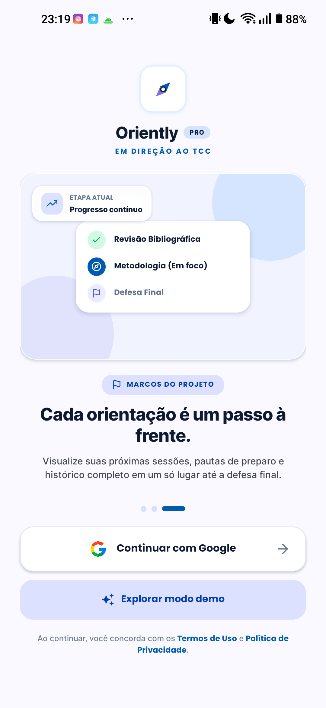
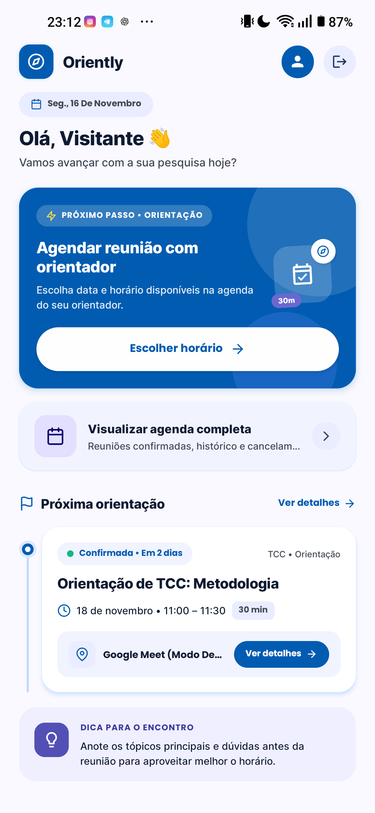
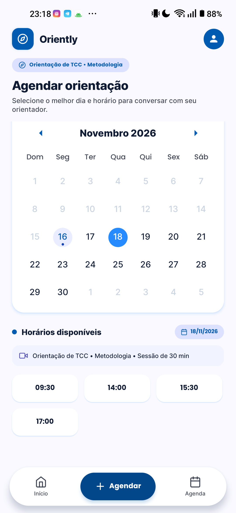
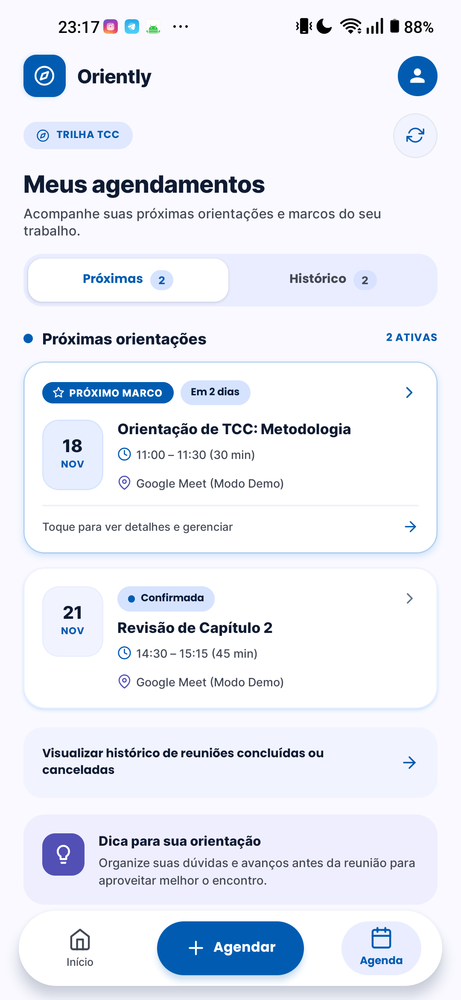
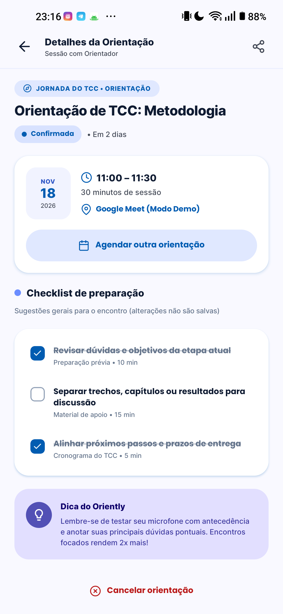

<div align="center">

# Oriently

**Seu TCC, no caminho certo.**

Aplicativo mobile para organizar orientações acadêmicas, consultar disponibilidades e gerenciar reuniões com integração ao Calendly.

[](https://www.typescriptlang.org/)
[](https://reactnative.dev/)
[](https://expo.dev/)
[](https://nodejs.org/)
[](LICENSE)

[Funcionalidades](#funcionalidades) · [Arquitetura](#arquitetura) · [Como executar](#como-executar) · [Documentação](#documentação)

</div>

---

## Sobre o projeto

O **Oriently** é um projeto acadêmico desenvolvido para a disciplina de **Desenvolvimento de Ambientes Móveis**. Seu objetivo é tornar mais simples a organização de encontros entre estudantes e orientadores durante o Trabalho de Conclusão de Curso (TCC).

Em vez de depender de trocas de mensagens para consultar horários, o estudante pode acessar a disponibilidade configurada no Calendly, selecionar uma data e confirmar uma orientação pela interface do aplicativo. A mesma experiência reúne os próximos encontros, o histórico e os detalhes dos agendamentos.

O projeto combina uma interface em **React Native com Expo** e um **backend BFF (Backend for Frontend)** em Node.js, responsável por intermediar a integração com o Calendly e manter o token da API fora do aplicativo.

## Interface

A identidade visual do Oriently utiliza elementos de bússola, calendário e trajetória para representar a jornada de orientação acadêmica.

| Login | Início (Home) | Agendamento |
|:---:|:---:|:---:|
|  |  |  |

| Agenda | Detalhes da Orientação |
|:---:|:---:|
|  |  |

> Para atualizar ou capturar todas as telas (`login.png`, `home.png`, `agendar.png`, `agenda.png`, `detalhes.png`) a partir de um aparelho Android conectado via ADB, execute `./scripts/capture-screenshots.ps1`.

## Funcionalidades

- **Autenticação Google:** acesso à experiência real com Google Sign-In e validação do ID Token no backend.
- **Modo demonstração navegável:** acesso offline com dados fictícios em memória (`src/services/demoData.ts`) para explorar Home, Agendamento, Agenda e Detalhes sem depender do BFF.
- **Disponibilidade de horários:** consulta de tipos de evento autorizados e horários disponíveis no Calendly.
- **Agendamento nativo:** seleção de data e horário e confirmação de orientação diretamente no aplicativo, por meio do BFF.
- **Agenda de orientações:** filtro entre orientações próximas e histórico (realizadas e canceladas), com navegação para detalhes.
- **Detalhes da reunião:** informações de data, duração, modalidade, link de videoconferência (quando fornecido e validado) e checklist de preparação.
- **Cancelamento protegido:** verificação da participação do usuário e tratamento diferenciado para eventos com múltiplos convidados.
- **Feedback de operações:** diálogos personalizados (`AppDialog`), estados de carregamento e tratamento de falhas de rede e indisponibilidade.

## Arquitetura

```text
┌─────────────────────────────┐
│ Aplicativo React Native     │
│ Expo · TypeScript           │
│ Login · Agenda · Agendamento│
└──────────────┬──────────────┘
               │ HTTPS / Bearer Google ID Token
               ▼
┌─────────────────────────────┐
│ Backend BFF (Node/Express)  │
│ Autenticação e autorização  │
│ Validação · Rate limiting   │
│ Idempotência de reservas    │
└──────────────┬──────────────┘
               │ Token privado no servidor
               ▼
┌─────────────────────────────┐
│ API do Calendly             │
│ Disponibilidade · Eventos   │
│ Agendamentos · Cancelamento │
└─────────────────────────────┘
```

O aplicativo **não precisa receber o token privado do Calendly**: a comunicação com essa API é intermediada pelo servidor. O backend valida os tokens de identidade do Google, restringe tipos de evento e aplica controles para reduzir agendamentos duplicados.

Detalhes e limitações dessa estrutura estão em [docs/ARCHITECTURE.md](docs/ARCHITECTURE.md).

## Tecnologias

| Camada | Tecnologias principais |
| --- | --- |
| Mobile | React Native, Expo, TypeScript |
| Interface | Styled Components, React Navigation |
| Autenticação | Google Sign-In, Google ID Token |
| Comunicação | Axios |
| Backend | Node.js, Express, TypeScript |
| Validação | Zod, `google-auth-library` |
| Agendamento | Calendly API |
| Testes | Node.js Test Runner e TypeScript |

## Como executar

> O aplicativo utiliza `@react-native-google-signin/google-signin` e requer um **Development Build** Android (`npx expo run:android`), não sendo compatível com o Expo Go.

### Início rápido (Modo demonstração)

Funciona offline, sem backend e sem credenciais Google/Calendly:

```bash
git clone https://github.com/Carlos-bub/oriently2025.git
cd oriently2025
npm ci
npx expo run:android
```

Na tela de login, toque em **"Explorar modo demo"**.

### Modo completo (Google + Calendly + BFF)

Consulte o passo a passo completo — incluindo Node.js, PowerShell, Google OAuth, SHA-1 Android, variáveis `.env` e execução do servidor `server/` — em [docs/SETUP.md](docs/SETUP.md).

## Testes

Na raiz do projeto:

```bash
npm run typecheck
npm test
```

No backend:

```bash
cd server
npm run typecheck
npm test
```

Os testes cobrem partes dos serviços mobile, validação de links, modo demo, rotas e comportamentos do backend. Eles **não substituem** testes manuais do login Google e do fluxo real com Calendly em um dispositivo.

## Estrutura do repositório

```text
oriently2025/
├── assets/                # Logo, splash e recursos estáticos do aplicativo
├── docs/
│   ├── images/            # Capturas de tela do aplicativo
│   ├── ARCHITECTURE.md    # Arquitetura e decisões técnicas
│   └── SETUP.md           # Instalação, configuração e execução
├── scripts/
│   └── capture-screenshots.ps1  # Script de captura via ADB
├── src/
│   ├── components/        # OrientlyTopBar, AppDialog, Loading, AcademicFlow
│   ├── contexts/          # Autenticação e diálogos
│   ├── global/            # Tema e estilos globais
│   ├── routes/            # Navegação e barra flutuante
│   ├── screens/           # Login, Home, Schedule, Profile e MeetingDetails
│   ├── services/          # Cliente HTTP, Calendly e modo demo
│   └── utils/             # Utilitários e validação de links
├── server/
│   └── src/               # API BFF, middlewares, rotas e testes
├── App.tsx
└── README.md
```

## Documentação

- [Arquitetura e decisões técnicas](docs/ARCHITECTURE.md)
- [Instalação, configuração e execução](docs/SETUP.md)

## Limitações e próximos passos

- Completar a galeria de capturas de todas as telas em `docs/images/` usando `./scripts/capture-screenshots.ps1`.
- Configurar integração contínua para executar automaticamente verificações e testes em Pull Requests.
- A persistência atual de idempotência é baseada em arquivo local e se destina a uma implantação de instância única; para múltiplas réplicas, seria necessário armazenamento compartilhado.
- A disponibilidade de links de videochamada e ações individuais depende dos dados efetivamente retornados pelo Calendly.

## Autoria

**Carlos Henrique Lima do Nascimento**  
Projeto acadêmico — Desenvolvimento de Ambientes Móveis (2025).

## Licença

Distribuído sob a licença [MIT](LICENSE).
